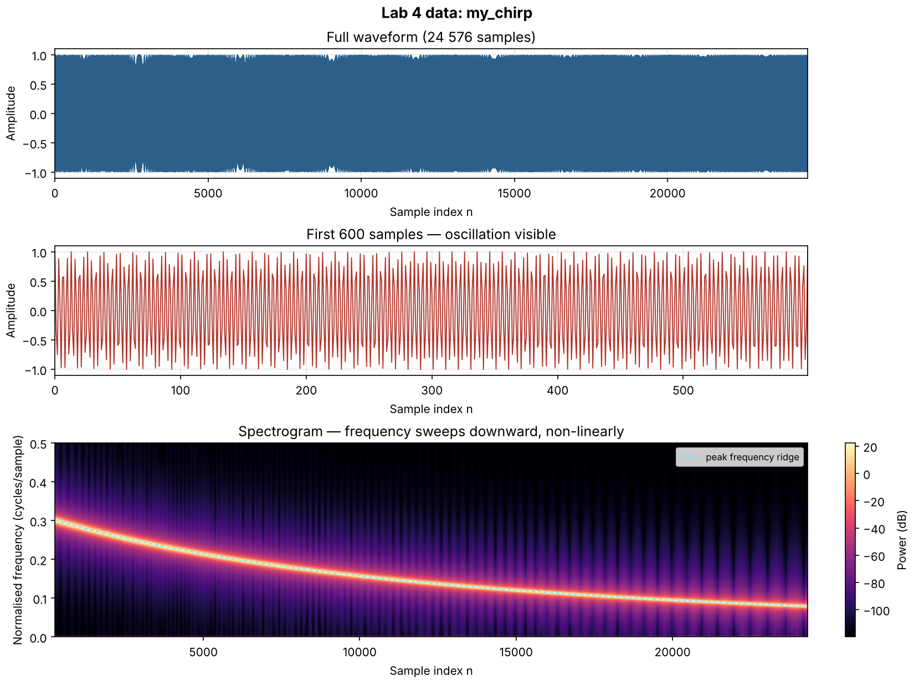
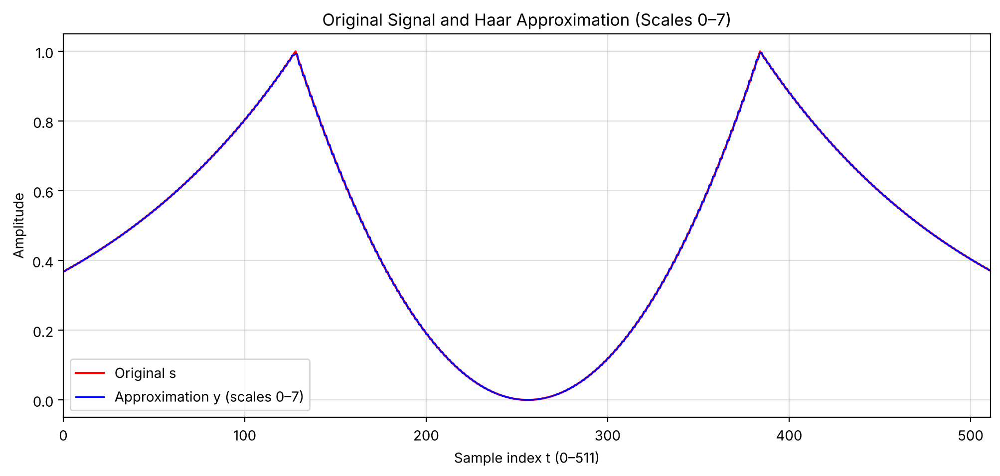
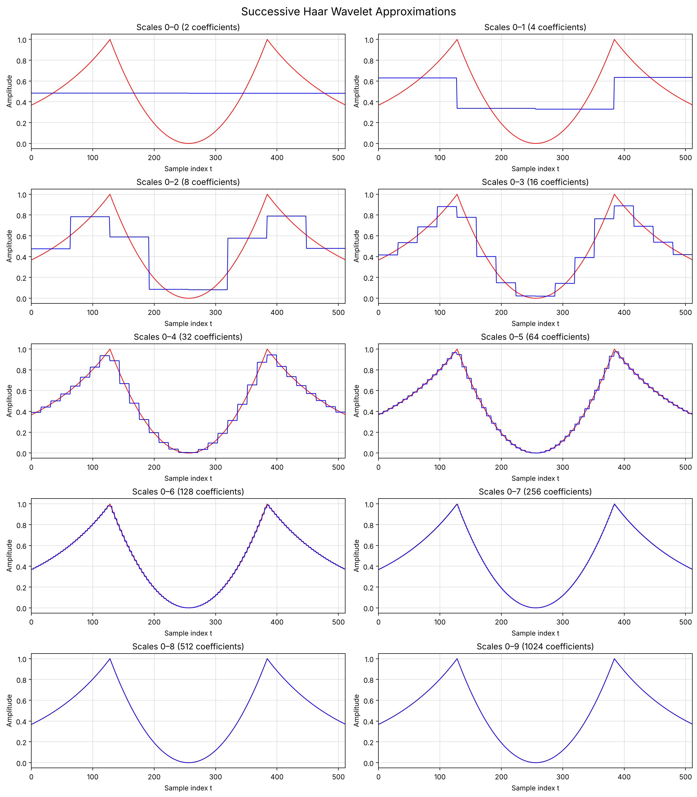

# Signal and Image Processing Labs

Six labs in MATLAB and Python covering wavelet analysis, transform coding,
image manipulation, and signal reconstruction. Each lab is self-contained in
its own directory with source, output and the original problem statement.

| Lab | Topic | Language |
|---|---|---|
| [04](#lab-04--chirp-signal-analysis) | Chirp signal analysis | MATLAB Live Script |
| [05](#lab-05--matrix-and-image-operations) | Matrix indexing and image transformations | MATLAB |
| [06](#lab-06--modular-arithmetic-image-recovery) | Modular-arithmetic image recovery | MATLAB |
| [07](#lab-07--haar-wavelet-approximation) | Haar wavelet multiresolution approximation | Python |
| [08](#lab-08--transform-coding) | M-term transform coding | MATLAB |
| [09](#lab-09--haar-wavelet-denoising) | Haar wavelet denoising | MATLAB |

---

## Lab 04 — Chirp Signal Analysis

A 24 576-sample chirp (`my_chirp.mat`) analysed in a MATLAB Live Script.



*Generated from `my_chirp.mat` for this README. The signal is full-scale
(±1.0, RMS 0.707) and its instantaneous frequency sweeps **downward** from
about 0.30 to 0.08 cycles/sample. The ridge is visibly curved — a straight-line
fit leaves a residual standard deviation of 0.015 — so the sweep is non-linear,
not the linear chirp the name might suggest. No sampling rate is stored with
the data, so frequency is shown in normalised units.*

Files: `LAB4_Khan.mlx` (Live Script), `LAB4_Khan.docx` (write-up), `my_chirp.mat`.

## Lab 05 — Matrix and Image Operations

MATLAB array manipulation building up to image processing:

- Indexing: submatrix extraction, reversed ranges, column permutation, and the
  distinction between `A(:,p)` and `A(p,:)` when `p` does not match the
  dimension.
- Matrix versus element-wise arithmetic — `B*B` against `B.*B`, and the
  `B*B == B.*B` comparison that shows where they coincide.
- Synthetic images from matrices: identity, uniform, random, and the coordinate
  grids `X = u'*a`, `Y = a'*u` used to render `X>Y`, `X.^2<Y`, and a
  cosine-shaded field `(cos((X+Y-1)*pi/2)).^6`.
- Image transformations on `cameraman.tif`: cropping, `rot90`, `fliplr`,
  `flipud`, transpose, `circshift`, thresholding, and gamma adjustment with
  exponents 0.8 and 1.05.
- A final challenge chaining crop → flip → gamma → resize.

Files: `lab05.m`, `lab05-output.pdf`.

## Lab 06 — Modular Arithmetic Image Recovery

An image `J` arrives "solarized": every pixel has had 147 added modulo 256, so
values wrap and the picture tears into false contours.

Recovery is one line:

```matlab
I = mod(J - 147, 256);
```

The reasoning matters more than the code. Addition modulo 256 is a **bijection**
on the set 0–255 — nothing is lost, values are only relabelled — so the
operation is exactly invertible by subtracting the same constant. No information
is destroyed and no approximation is involved.

Files: `lab06_part2.m`, `lab06-output.pdf`, `assignment.docx`.

## Lab 07 — Haar Wavelet Approximation

**Python.** Builds a normalised Haar basis from scratch and uses it for
multiresolution approximation of a piecewise-defined signal.

The test signal is three analytic pieces joined over 512 samples:
`exp(t-1)`, `(t-2)²`, and `exp(3-t)`.

`normalized_haar_matrix(n)` constructs the 512 × 512 basis directly: a constant
column scaled by `1/√n`, then for each dyadic scale a family of ±`1/√block`
step functions. It validates that `n` is a power of two.

### Verified results

Running `lab07_haar.py` in this environment (NumPy, Matplotlib):

```
Sample count: 512
V shape: (512, 512)
Reconstruction error: 1.83732686437e-15
Relative root mean square error = 0.006527228121
Percentage = 0.6527%
```

A reconstruction error of **1.8 × 10⁻¹⁵** is machine epsilon, which confirms the
constructed basis is genuinely orthonormal — `V @ V.T @ s` returns `s`. Keeping
scales 0–7 (256 of 512 coefficients, half the data) reproduces the signal to
**0.65% relative RMSE**.



Successive approximations across ten scales:



Files: `lab07_haar.py`, `lab07-output.pdf`, generated figures.

## Lab 08 — Transform Coding

`compress2(X, M)` keeps the `M` largest-magnitude entries of a complex 2-D
array, zeroes the rest, and reports where they were and how much energy survived:

```matlab
[Y, K, L, R] = compress2(X, M)
```

`Y` is the sparsified array, `K` and `L` the row and column indices of the
retained entries in MATLAB's column-major order, and `R` the retained energy
ratio `Σ|Y|² / Σ|X|²`. This is the core operation behind transform-coding
compression: most energy concentrates in few coefficients, so discarding the
rest costs little.

The function validates its inputs and uses `'like', X` so the output preserves
the input's numeric type.

### Verified against the specification

The assignment supplies a worked example. The algorithm was ported faithfully to
NumPy — column-major flattening, descending magnitude sort, `ind2sub`
equivalent — and run against it:

```
x = [ -1   3   4   7        M = 5
       8  -2   1   1
       0 -13   1   4 ]

Y produced:          [K L] produced:      Energy ratio
[  0   0   4   7 ]   [2 1]                R = 0.948640
[  8   0   0   0 ]   [3 2]                (314 / 331)
[  0 -13   0   4 ]   [1 3] [1 4] [3 4]
```

Both `Y` and `[K L]` match the specified output **exactly**. Keeping 5 of 12
entries retains 94.9% of the energy.

Note this verifies the *algorithm*, not the MATLAB file itself — no MATLAB or
Octave interpreter was available here. The script also contains its own
`assert` cross-checking the inline code against the function.

Files: `lab08_script.m`, `compress2.m`, `lab08-output.pdf`, `assignment.txt`.

## Lab 09 — Haar Wavelet Denoising

A faint message is hidden in a 512 × 512 image under additive noise. Message and
noise are **orthogonal in the wavelet domain**: noise has zero projection onto
Haar scales 0…L−1, the message has zero projection onto scales L…9. Separation
is therefore exact rather than a trade-off.

The method:

1. Apply the iterative Haar transform `C ← P·C·Pᵀ` over four stages, halving the
   active block each time.
2. Inspect the top-left block at each stage. When it goes uniform, the message
   and noise have separated — this is what reveals **L**.
3. With 10 wavelet scales and 4 stages applied, **L = 6**.
4. Zero everything outside the top-left `n × n` block, keeping only message
   coefficients.
5. Invert the transform with `Cclean ← Pᵀ·Cclean·P`, running the stages backward.

The recovered message reads **"222 ROCKS!"**.

Files: `lab09_haar_denoise.m`, `lab09-output.pdf`, `assignment.txt`.

---

## Running These

**MATLAB.** Labs 05, 06, 08 and 09 need MATLAB; Lab 05 also needs the Image
Processing Toolbox for `imread`/`imshow`. Lab 04 opens as a Live Script.

**Python.** Lab 07 needs only NumPy and Matplotlib:

```bash
pip install numpy matplotlib
python lab07-haar-approximation/lab07_haar.py
```

### Missing dependencies

Some labs reference course-supplied files that are **not in this repository**
and are not mine to redistribute. Those labs will not run as-is:

| Lab | Needs | What it is |
|---|---|---|
| 05 | `cameraman.tif` | Ships with the MATLAB Image Processing Toolbox |
| 06 | `modball`, `im222` | Course-supplied image data and a display helper |
| 09 | `hiddenmsg.mat`, `iterate_haar` | Course-supplied data and Haar matrix generator |

Lab 07 and Lab 08's `compress2` are fully self-contained — Lab 07 runs directly,
and `compress2` works on any numeric matrix you pass it.

## Repository Structure

```
.
├── lab04-chirp-analysis/          Live Script, write-up, my_chirp.mat
├── lab05-matrix-and-image-ops/    MATLAB script, output PDF
├── lab06-modular-image-recovery/  MATLAB script, output PDF, assignment
├── lab07-haar-approximation/      Python script, output PDF, figures
├── lab08-transform-coding/        script, compress2.m, output PDF, assignment
├── lab09-haar-denoising/          MATLAB script, output PDF, assignment
├── images/                        figures generated for this README
└── README.md
```
